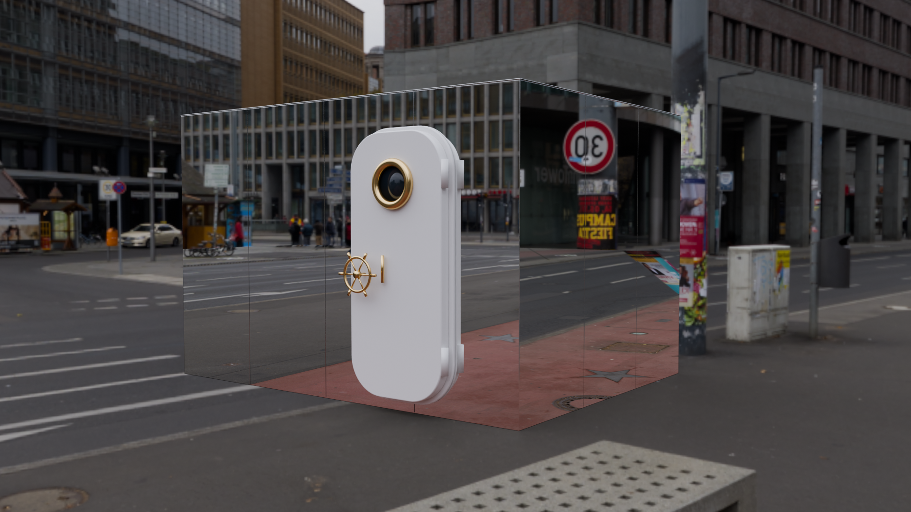

# Box miroir — porte de bateau

Box habillée de miroirs avec une porte de bateau (hublot et volant en laiton), modélisée dans Blender.

**Visionneuse 3D en ligne :** https://gallice1312.github.io/box-miroir/



## Contenu

- `box_miroir.py` — script Blender qui génère la scène (dimensions réglables en haut du fichier)
- `box_miroir.blend` — la scène Blender
- `docs/` — la visionneuse web (three.js) : `index.html` (page blanche), `box-viewer.js` (la 3D, montée dans `#box-viewer`), `box.glb`, HDRI pour les reflets

## Régénérer la scène

Le rendu utilise l'HDRI [Potsdamer Platz](https://polyhaven.com/a/potsdamer_platz) (Poly Haven, CC0) en 4K :

```sh
curl -LO https://dl.polyhaven.org/file/ph-assets/HDRIs/hdr/4k/potsdamer_platz_4k.hdr
blender -b -P box_miroir.py
```

## Lancer la visionneuse en local

```sh
cd docs && python3 -m http.server 8765
```

Puis ouvrir http://127.0.0.1:8765/
